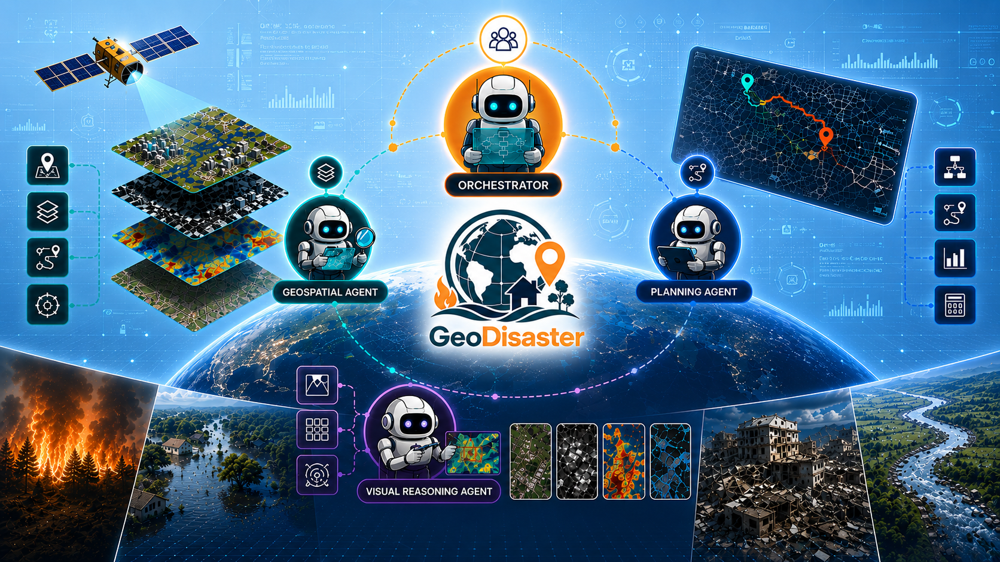
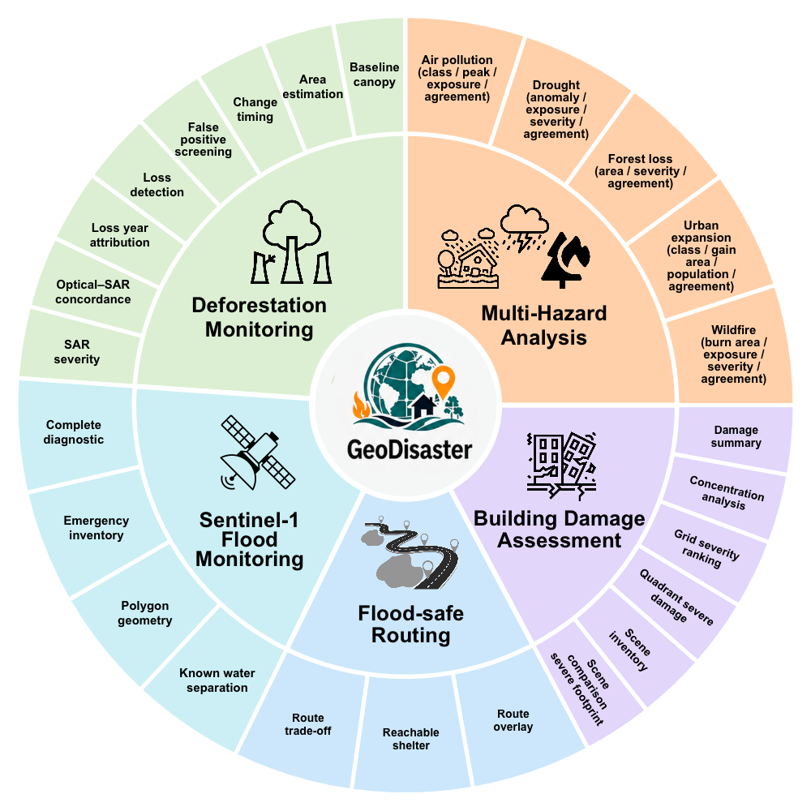
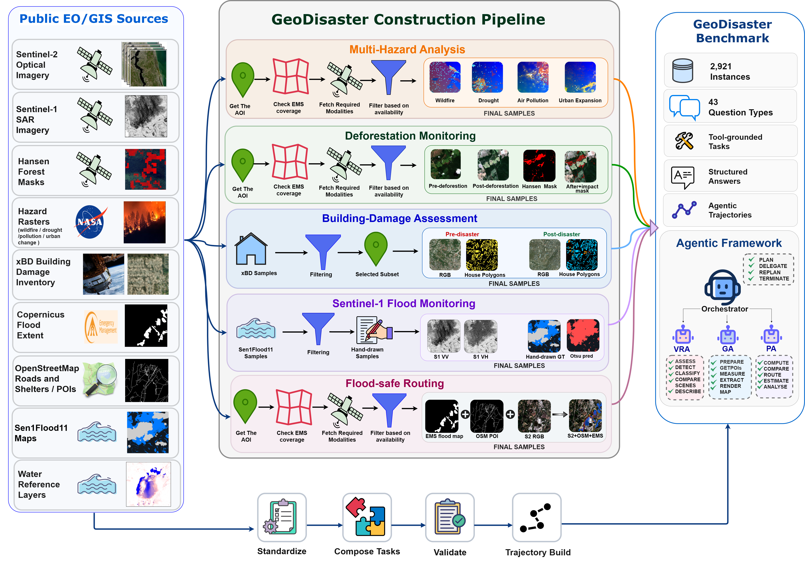
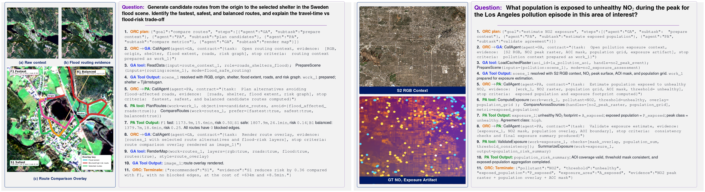
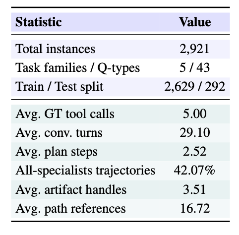
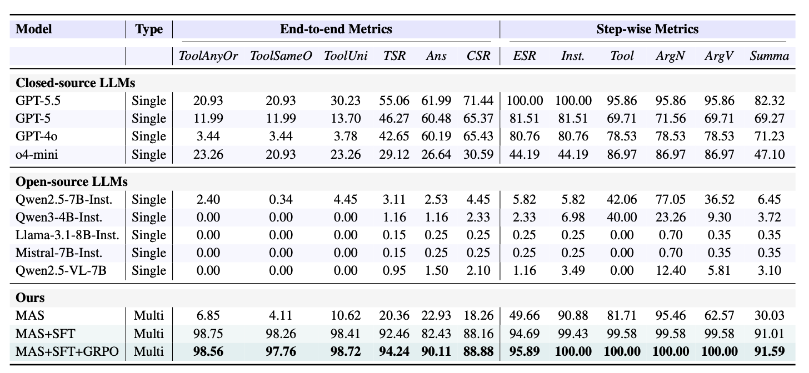
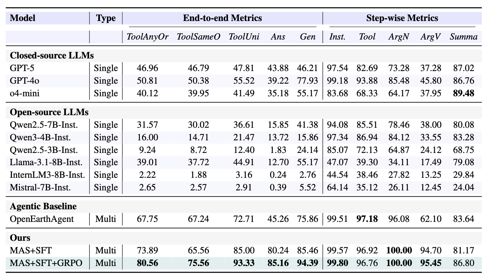

<p align="center">
  
</p>

<h1 align="center">
[BMVC'26] GeDisaster: Benchmarking Orchestrated Agents for Operational Disaster Geo-Intelligence
</h1>

<p align="center">
<span style="display:inline-block; width:120px; height:5px; background:#f4a261;"></span>
<span style="display:inline-block; width:120px; height:5px; background:#e76f51;"></span>
<span style="display:inline-block; width:120px; height:5px; background:#e63946;"></span>
<span style="display:inline-block; width:120px; height:5px; background:#457b9d;"></span>
<span style="display:inline-block; width:120px; height:5px; background:#2a9d8f;"></span>
</p>

<p align="center">
<a href="https://github.com/VIMAGE-IITB/GeoDisaster">Maram Hasan</a>,
<a href="https://github.com/VIMAGE-IITB/GeoDisaster">Aman Verma</a>,
<a href="https://github.com/VIMAGE-IITB/GeoDisaster">Savitra Roy</a>,
<a href="https://github.com/VIMAGE-IITB/GeoDisaster">Hariseetharam Gunduboina</a>,
<a href="https://github.com/VIMAGE-IITB/GeoDisaster">Daksh Jain</a>,<br>
<a href="https://github.com/VIMAGE-IITB/GeoDisaster">Muhammad Haris Khan</a>,
<a href="https://github.com/VIMAGE-IITB/GeoDisaster">Subhasis Chaudhuri</a>,
<a href="https://github.com/VIMAGE-IITB/GeoDisaster">Biplab Banerjee</a>
</p>

<p align="center">
<b>
Indian Institute of Technology Bombay, &nbsp;&nbsp; &nbsp;&nbsp;
Mohamed bin Zayed University of Artificial Intelligence
</b>
</p>

<p align="center">
<a href="https://huggingface.co/datasets/vimageiitb/geodisaster-agentic-2921"></a>
<a href="code/README.md"></a>
<a href="LICENSE"></a>
</p>

---

## 🧩 News

- GeoDisaster benchmark, code, and documentation are prepared under the official project repository.
- The Hugging Face dataset release contains the complete 2,921-instance benchmark, single-agent and multi-agent trajectories, training splits, bundled redistributable source assets, and a pinned installer for the selected Sen1Floods11 inputs.

---

## 🌍 Overview

GeoDisaster is an operational geospatial disaster reasoning benchmark and orchestrated multi-agent framework for geo-intelligence.

The project introduces:

- An agentic benchmark of **2,921 verified instances** across **43 question types** and **five disaster task families**.
- Heterogeneous EO/GIS evidence, including optical imagery, SAR imagery, raster masks, vector geometries, road networks, exposure layers, and structured artifacts.
- A **contract-driven orchestrated multi-agent framework** with **18 disaster-oriented geospatial tools**.
- **Role-Contract Expectation Alignment (RCEA)**, combining contract-aligned supervised fine-tuning with contract-grounded reinforcement learning over dense step-level signals.

  
https://github.com/user-attachments/assets/a3df2cb5-809f-4a13-8078-a893e3e50b43


**GeoDisaster** evaluates whether agents can transform heterogeneous EO/GIS inputs into grounded operational disaster decisions through valid multi-step reasoning, structured intermediate state tracking, and evidence-backed final responses.

---


## 🌋 GeoDisaster Benchmark

GeoDisaster is a multi-task agentic benchmark for operational geospatial disaster reasoning. It is constructed from public EO/GIS source families and converted into standardized task instances with visible inputs, structured answer targets, and executable geospatial workflows.

<p align="center">
  
</p>

GeoDisaster covers five operational disaster task families:

- **Deforestation Monitoring**
- **Multi-Hazard Analysis**
- **Building-Damage Assessment**
- **Flood-Safe Routing**
- **Sentinel-1 SAR Flood Monitoring**

These families span forest-loss detection, hazard measurement, exposure estimation, damage inventory, flood-aware routing, SAR flood inventory, and structured flood reporting.

---


## 🏗️ Data Construction Pipeline

<p align="center">
  
</p>

Public EO/GIS sources are ingested and standardized into five disaster task families, validated through executable geospatial workflows, and converted into agentic trajectories comprising orchestrator plans, specialist-agent actions, tool calls, observations, intermediate state summaries, and structured outputs.

Ground-truth answers are produced through deterministic geospatial workflows and consistency checks rather than language-model annotation. This supports evaluation of both final correctness and intermediate reasoning validity.

---

## 🖼️ Example Tasks

GeoDisaster includes tasks that require agents to combine satellite evidence, geospatial artifacts, tool outputs, and structured reasoning trajectories.

<p align="center">
  
</p>

Representative examples include:

- **Flood-safe routing:** satellite context and packaged flood-screened route candidates are used to select and compare the declared rank-one fastest, safest, and balanced alternatives. Visual tasks render fresh run-scoped overlays from declared RGB/vector layers and the current route handle. The benchmark does not rerun a road-graph optimizer.
- **Multi-hazard exposure estimation:** satellite context and exposure artifacts are used to estimate population exposure under unhealthy NO₂ conditions.
- **Building-damage assessment:** pre/post-disaster imagery and building polygons are used to identify severe damage, rank affected regions, and produce structured damage summaries.

See [`examples/README.md`](examples/README.md) for additional examples.

---

## 📊 Dataset Statistics

<p align="center">
  
</p>

GeoDisaster contains **2,921 verified instances**, spans **5 task families** and **43 question types**, and includes trajectories requiring multi-step tool-grounded reasoning. The dataset includes heterogeneous raster, vector, graph, image, and metadata evidence, while preserving family-specific disaster reasoning requirements. The **average trajectory** involves **5** ground-truth **tool calls**, **29.10 conversation turns**, and **2.52 planning steps**, indicating sustained multi-step reasoning and subgoal decomposition. Notably, **42.07%** of trajectories **activate all specialist agents**, showing that coordinated visual, geospatial, and planning capabilities are often necessary rather than incidental.


See [`dataset/README.md`](dataset/README.md) for full dataset details.

---
## 🛰️ Framework Overview

GeoDisaster formulates disaster geospatial reasoning as an orchestrated multi-agent decision process. Given a natural-language query, remote-sensing observations, and geospatial context, the system produces a grounded final response through intermediate planning, tool use, artifact generation, and state-aware synthesis.

The framework contains four role-specialized agents:

- **Orchestrator Agent (ORC):** decomposes the task, assigns subtasks, tracks execution state, handles recovery, and terminates with a runtime-published answer reference.
- **Geospatial Agent (GA):** executes geospatial operations such as boundary retrieval, distance computation, map rendering, route preparation, and spatial artifact handling.
- **Visual Reasoning Agent (VRA):** handles image, raster, mask, and visual evidence reasoning, including interpretation of optical, SAR, and derived disaster layers.
- **Planning Agent (PA):** supports numerical computation, filtering, planning logic, route comparison, exposure estimation, and structured decision evidence.

Agents collaborate through explicit execution contracts rather than free-form delegation. Each plan step names its specialist, evidence dependencies, and subgoal; tool calls follow generated argument schemas and role ownership; the runtime projects successful worker evidence into the question's declared JSON Schema and publishes a stable reference for model termination. This makes intermediate execution verifiable and enables dense step-level evaluation.

See [`code/README.md`](code/README.md) for implementation details.

---
## 🤖 Multi-Agent Alignment

We propose **Role-Contract Expectation Alignment (RCEA)**, a contract-aligned two-stage protocol that combines role-conditioned supervised fine-tuning with contract-grounded reinforcement learning over dense step-level signals.

The key insight is that execution contracts produce observable, step-level violations that enable role-conditioned credit assignment. This allows each agent to be optimized against its assigned contract obligations rather than only against the terminal trajectory outcome.

### Contract-Aligned Supervised Fine-Tuning

Each agent is trained on role-conditioned, contract-compliant success trajectories. The released SFT targets include valid plans, tool calls, handle transitions, successful completion decisions, and the stable answer-reference protocol. Every target satisfies the active role contract, state validator, and declared evidence boundary. The released SFT set does not contain synthetic failure-recovery trajectories; recovery is exercised by live evaluation and can be optimized from failures encountered during the reinforcement stage.

### Contract-Grounded Reinforcement Learning

The reinforcement stage applies contract-grounded learning with dense per-step contract-satisfaction signals on top of the SFT adapters. This supports role-specific credit assignment and stable multi-agent execution.

Training implementation, prompts, contracts, SFT scripts, and GRPO scripts are documented in [`code/README.md`](code/README.md).

---

## 📈 Main Results
We evaluate our agentic framework on two remote-sensing agentic benchmarks: **GeoDisaster**, which assesses disaster-oriented operational geospatial decision-making, and **OpenEarthAgent**, which evaluates generalization on an existing tool-augmented remote-sensing benchmark with broad geospatial task coverage.

**Metrics:** we report final-task metrics and process-level tool-use fidelity. Tool-use fidelity is evaluated using order-agnostic matching **(ToolAnyOr)**, exact-order matching **(ToolSameO)**, and unique-tool matching **(ToolUni)**. We also report **TSR** for task success rate, **Ans** for answer accuracy, **CSR** for contract satisfaction, and **ESR** for strict episode resolution. Step-wise metrics include instruction following **(Inst.)**, tool selection **(Tool)**, argument-name correctness **(ArgN)**, argument-value correctness **(ArgV)**, and summarization quality **(Summa)**. The best results are shown in **bold**.

### GeoDisaster Benchmark

<p align="center">
  
</p>

**Key observation.** GeoDisaster shows a substantial capability gap between standalone LLMs and contract-aligned multi-agent execution. The full model, **MAS+SFT+GRPO**, achieves the strongest overall performance with **90.11 answer accuracy**, **94.24 task success**, and **100.00** step-wise instruction following, tool selection, argument-name correctness, and argument-value correctness, **substantially outperforming** both **open-source** and **closed-source** single-model baselines.

---

### OpenEarthAgent Benchmark

<p align="center">
  
</p>

**Key observation.** The aligned framework transfers beyond GeoDisaster and **outperforms** the **OpenEarthAgent** **agentic** **baseline** **on its own benchmark**. **MAS+SFT+GRPO** improves answer accuracy from **45.26 to 85.16**, generative accuracy from **75.86 to 94.39**, unique-tool fidelity from **72.71 to 93.33**, and argument-value correctness from **62.10 to 95.45**, showing that role-specialized orchestration and contract-grounded alignment generalize across structurally different remote-sensing agentic benchmarks.

For additional experiments, ablations, backbone sensitivity, and error analysis, please refer to the paper.

---

## 📁 Repository Structure

```text
GeoDisaster/
├── README.md
├── code/
├── dataset/
├── examples/
├── docs/
├── assets/
├── LICENSE
└── CITATION.cff
```

---

## 📚 Citation


```bibtex
@article{hasan2026geodisaster,
  title={GeoDisaster: Benchmarking Orchestrated Agents for Operational Disaster Geo-Intelligence},
  author={Hasan, Maram and Verma, Aman and Roy, Savitra and Gunduboina, Hariseetharam and Jain, Daksh and Khan, Muhammad Haris and Chaudhuri, Subhasis and Banerjee, Biplab},
  journal={arXiv preprint arXiv:2606.17246},
  year={2026}
}
```
